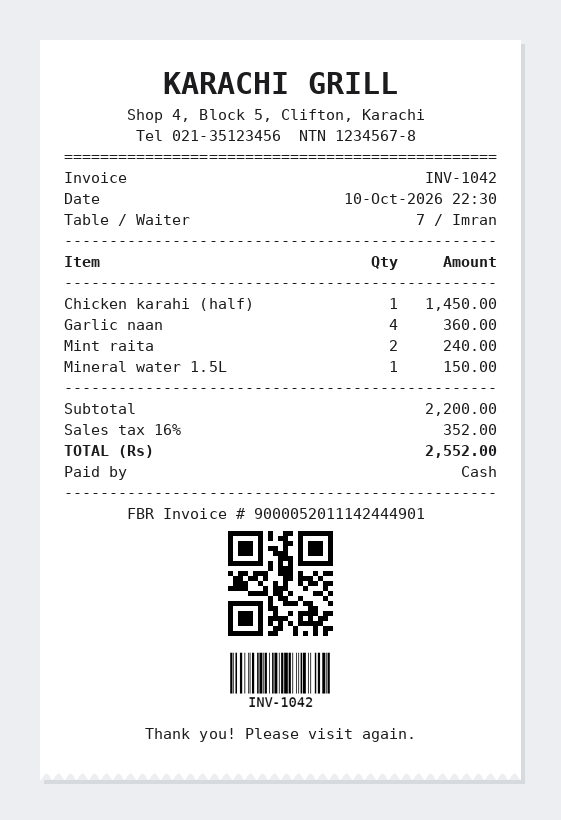

# .NET ESC/POS Receipt Printer

Print receipts on thermal printers from C#. A fluent builder for text, columns, barcodes,
**QR codes**, logos, cash drawer and paper cut, plus drivers for **network**, **Windows (USB)**
and device file printers. Works with Epson, Xprinter, Rongta, Bixolon, Star (ESC/POS mode) and
the many compatible 58 mm and 80 mm printers used in shops and restaurants.

No dependencies. .NET 8.

[](https://github.com/softechies/dotnet-escpos-printer/actions/workflows/build.yml)




*The sample receipt from [`samples/ReceiptDemo`](samples/ReceiptDemo/Program.cs).*

## Quick start

```csharp
using EscPos;
using EscPos.Printing;

Column[] items = [new(0), new(4, Align.Right), new(10, Align.Right)];

var receipt = new ReceiptBuilder(charsPerLine: 48)        // 48 for 80 mm, 32 for 58 mm
    .Align(Align.Center).Bold().Size(2, 2).Line("KARACHI GRILL").Normal()
    .Align(Align.Center).Line("Shop 4, Block 5, Clifton, Karachi").Normal()
    .Separator('=')
    .Row(items, "Item", "Qty", "Amount")
    .Row(items, "Chicken karahi (half)", "1", "1,450.00")
    .Row(items, "Garlic naan", "4", "360.00")
    .Separator()
    .LeftRight("Subtotal", "1,810.00")
    .Bold().LeftRight("TOTAL (Rs)", "2,099.60").Bold(false)
    .Align(Align.Center)
    .QrCode("9000052011142444901")
    .Line("Thank you!")
    .OpenDrawer()
    .Cut()
    .ToArray();

await new NetworkPrinter("192.168.1.50").PrintAsync(receipt);
```

## Features

| | |
|---|---|
| **Text** | Alignment, bold, underline, inverted, font A/B, sizes 1× to 8×, automatic word wrap |
| **Layout** | Columns with per column alignment and wrapping, left/right lines with dot leaders, separators |
| **Codes** | QR codes printed natively by the printer (size, error correction), Code128, EAN-13, EAN-8, UPC-A, Code39 and more |
| **Images** | Logos from BMP files or RGBA pixels, scaled to the paper, sent in bands for small printer buffers |
| **Hardware** | Paper cut (full or partial), cash drawer kick (pin 2 or 5), real-time status (paper out, cover open) |
| **Printers** | Network (TCP 9100), Windows installed printers (USB) as RAW, device paths like `/dev/usb/lp0` |
| **Text encoding** | Code pages PC437, PC850, PC858, Windows-1252; curly quotes, dashes and `₨` turned into printable text |
| **Preview** | `ReceiptPreview.Render(bytes)` turns the bytes back into text, for tests, logs or on-screen previews |

## Printers

```csharp
// Ethernet / Wi-Fi printer
await new NetworkPrinter("192.168.1.50").PrintAsync(bytes);

// USB printer installed in Windows (name as shown in Printers & scanners)
await new WindowsPrinter("POS-80C").PrintAsync(bytes);

// Linux USB device, or a file to inspect
await new FilePrinter("/dev/usb/lp0").PrintAsync(bytes);

// Check before printing
var status = await new NetworkPrinter("192.168.1.50").GetStatusAsync();
if (status is { Ready: false }) Console.WriteLine(status);   // PaperEnd, CoverOpen, ...
```

`WindowsPrinter` sends the bytes to the spooler as RAW, so it works with the vendor driver or with
Windows' "Generic / Text Only" driver. For serial printers, open the port with `System.IO.Ports`
and write `ToArray()`.

## Paper width

| Paper | Font A characters | Image width (203 dpi) |
|---|---|---|
| 80 mm | 48 (some models 42) | 576 dots |
| 58 mm | 32 | 384 dots |

Pass the character count to `new ReceiptBuilder(...)`; `Size(2, 2)` and font B adjust the width
used for wrapping automatically.

## Logos

```csharp
var logo = MonoImage.FromBmp("logo.bmp");          // 1, 24 or 32 bit BMP
builder.Align(Align.Center).Image(logo, maxWidthDots: 384);
```

Using ImageSharp or SkiaSharp already? Pass the pixels in with `MonoImage.FromRgba(pixels, width, height)`.

## FBR receipts (Pakistan)

FBR integrated POS receipts need the Fiscal Invoice Number and a QR code of it:

```csharp
builder.Align(Align.Center)
    .Line($"FBR Invoice # {fbrInvoiceNumber}")
    .QrCode(fbrInvoiceNumber, moduleSize: 5)      // about 0.7 to 1 inch on most printers
    .Image(fbrLogo, maxWidthDots: 200);
```

Pair it with [fbr-pos-integration](https://github.com/softechies/fbr-pos-integration) to get the number.

## Testing without a printer

```csharp
var text = ReceiptPreview.Render(bytes, charsPerLine: 48);
// "           KARACHI GRILL\n ... [QR: 9000052011142444901]\n[PARTIAL CUT]"
```

Run the sample to see a full receipt in the console, or send it to a real printer:

```bash
dotnet run --project samples/ReceiptDemo
dotnet run --project samples/ReceiptDemo -- --ip 192.168.1.50
dotnet run --project samples/ReceiptDemo -- --windows "POS-80C" --width 48
```

## Tests

```bash
dotnet test
```

Byte exact checks for every command, layout and wrapping rules, image packing and BMP loading,
and a fake network printer for printing and status replies. CI runs on Linux and Windows.

## Notes

- Urdu and Arabic text can't be printed with the built in fonts of most receipt printers.
  Render that text to an image in your app and print it with `Image(...)`.
- Some printers need a different cut command or drawer timing; `Raw(...)` sends anything else.

## License

MIT

---

Built and maintained by [Softechies Solutions](https://softechies.net). We build POS, printing
and Windows software in .NET: receipt and label printing, print drivers, IPP servers and Windows services.
